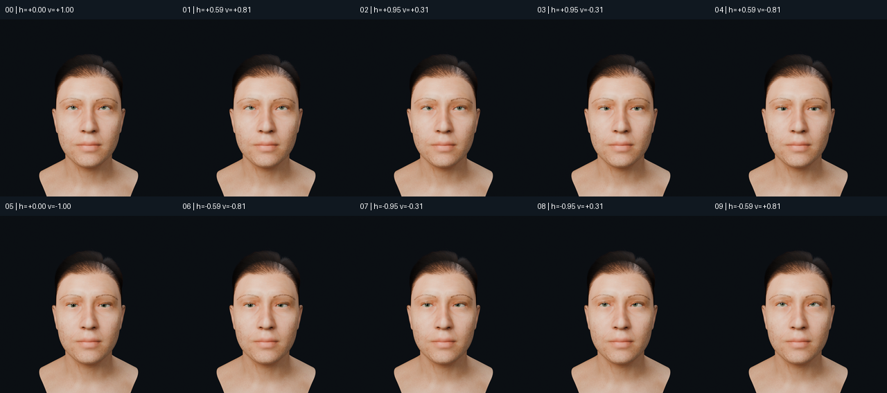

# GazeForge XR

**VITChennai_IrisX · Samsung XR Track 01**

- Blender face rig for labelled gaze images and eye-movement sequences.
- Both eyes rotate about fixed centres and follow one shared target.
- Eyelid closure, gaze follow and eyebrow controls.
- Five texture looks using the original GNM UV layout.

## Submission download

- [Download VITChennai_IrisX.zip](https://github.com/akxxh222/GazeForge-XR/releases/download/v1.0.0/VITChennai_IrisX.zip)
- [SHA-256 checksum](https://github.com/akxxh222/GazeForge-XR/releases/download/v1.0.0/VITChennai_IrisX.zip.sha256)
- [Release notes](https://github.com/akxxh222/GazeForge-XR/releases/tag/v1.0.0)

## Quick review

1. Open [scene.blend](scene.blend) in **Blender 5.2.3 LTS**. The textures are packed; no add-ons are needed.
2. Press **F12** for the Cycles render. Material Preview is useful for navigation, but its hair and cornea shading differs from the final render.
3. Play frames **1–144** to see the six-second gaze sequence and blinks.
4. Review the [presentation](demo/presentation.pptx), [90-second overview](demo/overview.mp4) and rendered images below.

| Path | Contents |
| --- | --- |
| [scene.blend](scene.blend) | Editable face, eye bones, lids, materials, camera and lights |
| [wrapper/](wrapper/) | Gaze, expression, texture and capture controls |
| [renders/](renders/) + [metadata.json](metadata.json) | Ten clockwise 1024 × 1024 PNGs and their labels |
| [videos/](videos/) | Left, Right and GenerateMotion; six seconds each |
| [textures/](textures/) | Five native face/eye map sets and shared sclera height maps |
| [previews/](previews/) | One front and one eye close-up per look |
| [demo/](demo/) | Presentation and 90-second overview |
| [tests/](tests/) | Validation results and capture receipts |
| [docs/](docs/) | Rig/metadata notes and asset credits |

## Documents and videos

| Item | Link |
| --- | --- |
| Presentation | [PowerPoint deck](demo/presentation.pptx) |
| Project overview | [90-second video](demo/overview.mp4) |
| Motion sequences | [Left](videos/left.mp4) · [Right](videos/right.mp4) · [GenerateMotion](videos/generate_motion.mp4) |
| Milestones | [Five-stage progress summary](MILESTONES.md) |
| Methods | [Rig, textures and metadata](docs/METHODS.md) |
| Asset credits | [Sources and licences](docs/ASSETS.md) |
| Validation | [Results summary](tests/report.md) · [Detailed results](tests/report.json) |
| Portability check | [Extracted ZIP results](tests/fresh_extraction.json) |
| Project licence | [MIT licence](LICENSE) |

## Rendered images

Ten official clockwise gaze renders, combined in one contact sheet:

[](contact_sheet.png)

| Official PNGs | Individual frames |
| --- | --- |
| 00–04 | [00](renders/frame_00.png) · [01](renders/frame_01.png) · [02](renders/frame_02.png) · [03](renders/frame_03.png) · [04](renders/frame_04.png) |
| 05–09 | [05](renders/frame_05.png) · [06](renders/frame_06.png) · [07](renders/frame_07.png) · [08](renders/frame_08.png) · [09](renders/frame_09.png) |

| Texture look | Face render | Eye close-up |
| --- | --- | --- |
| 01 | [Face](previews/look_01_front.png) | [Eyes](previews/look_01_eyes.png) |
| 02 | [Face](previews/look_02_front.png) | [Eyes](previews/look_02_eyes.png) |
| 03 | [Face](previews/look_03_front.png) | [Eyes](previews/look_03_eyes.png) |
| 04 | [Face](previews/look_04_front.png) | [Eyes](previews/look_04_eyes.png) |
| 05 | [Face](previews/look_05_front.png) | [Eyes](previews/look_05_eyes.png) |

## Rendering

- Working directory: repository root.
- Blender executable in this example: `E:\Apps\blender.exe`.

```powershell
& 'E:\Apps\blender.exe' --background --factory-startup --disable-autoexec --python-exit-code 1 --python scripts/render_expressions.py -- --mode all --duration 6 --fps 24 --resolution 720 --samples 96 --official --official-samples 192
```

- Output folder: `runtime/capture/`. Supplied results remain unchanged.
- Ten-image export only: use `--official-only` instead of `--mode all --official`.
- Videos: 720 × 720, 24 fps, six seconds each.
- Official images: 1024 × 1024 PNG.
- Cycles uses an available GPU, with CPU fallback. Full rendering is slower on the CPU.

## Python controls

Blender Python Console setup:

```python
import bpy, sys
from pathlib import Path
project = Path(bpy.data.filepath).parent
sys.path.insert(0, str(project))
from wrapper import eyes, expressions, submission_looks
```

| Control | Behaviour |
| --- | --- |
| `eyes.move(h, v)` | Inputs from −1 to +1; positive `h` is image right, positive `v` is up |
| `eyes.reset()` | Returns gaze to the centre |
| `expressions.use_action('left')` | Selects a sequence; other names are `right` and `generate_motion` |
| `submission_looks.apply_look('look_02')` | Selects a texture look; IDs range from `look_01` to `look_05` |

Manual render with open lids:

```python
with expressions.manual():
    expressions.reset()
    eyes.move(-1, 0)
    eyes.render('runtime/manual_left.png')
```

- Manual gaze pauses the eye and target actions so the requested pose stays in place.
- The manual context restores the previous timeline actions afterwards.

## Calibration and labels

| Setting | Value |
| --- | --- |
| Camera distance from eye midpoint | 40 cm |
| Target plane distance | 35 cm |
| Target movement | Up to ±5 cm horizontally and vertically |
| Clockwise sequence | Ten samples, starting at the top |
| Sample formula | `theta = 2*pi*k/10`, `h = sin(theta)`, `v = cos(theta)` |
| World axes | X right, Y behind the subject, Z up |
| Units | Metres; world XYZ Euler rotations in radians |
| Image coordinates | Top-left origin; anatomical eye L appears on image right |

- Pupil labels mark the projected geometric aperture centre.
- Corneal refraction can shift the apparent pupil centre in a render.
- The 3 × 4 `camera_matrix` produces homogeneous pixel coordinates.
- Projection formula and field definitions: [docs/METHODS.md](docs/METHODS.md).

## Validation and packaging

```powershell
python -m pip install -r requirements.txt
python scripts/verify_submission.py
```

- Verification covers file hashes, video decoding, image sizes, sequence order and metadata.
- Results summary: [tests/report.md](tests/report.md).
- Detailed results: [tests/report.json](tests/report.json).
- ZIP build command: `python scripts/package_submission.py`.
- The ZIP and checksum are published as GitHub Release attachments and excluded from Git history.

## AI disclosure

- OpenAI Codex provided substantial assistance with Blender/Python implementation, rig and material setup, debugging, rendering automation, validation, documentation and presentation preparation.
- Our team set the requirements and reviewed successive scene revisions, including eye alignment and appearance.
- Final images and motion clips were rendered in Blender using the credited public assets in [docs/ASSETS.md](docs/ASSETS.md).
- The overview video combines those renders with captions.

## Limitations

- Fine eyelid detail and hair around the temples remain approximations.
- Corneal shading includes an artistic shadow-transmission adjustment.
- The scene is not a measured optical model; motion has not been biologically validated.
- Asset credits and licence terms: [docs/ASSETS.md](docs/ASSETS.md).

## Viewer notes

- Solid shading displays the face without its skin materials.
- Material Preview differs from the final Cycles render, especially for hair and corneas.
- Texture switching uses the exported folder structure. Default scene textures are also packed in `scene.blend`.
